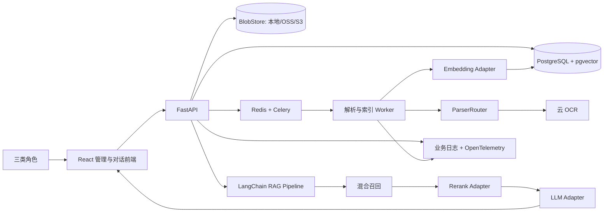

# 企业知识库中台 V1.0：需求审查与技术方案（待确认）

> 日期：2026-10-26  
> 当前状态：前端可点击原型已完成（Mock）；后端与真实数据链路尚未开始  
> 项目现状：`frontend/` 可运行，`docs/` 为 V1.0 技术方案

## 0. 结论先行

V1.0 建议只交付这一条可验收闭环：

**管理员配置模型与 OCR → 知识库管理人员新建知识库并导入文件 → 系统异步解析、切片、向量化 → 管理人员预览分块并完成检索测试 → 使用者选择知识库在线提问 → 系统检索、重排、流式生成带原文引用的回答 → 管理员查看查询、Token、耗时与错误日志。**

建议采用两个确认闸门：

1. 本文方案确认后，才开始前端原型。
2. 可点击原型确认后，才开始后端与真实数据链路开发。

推荐默认技术栈：

- 前端：React + TypeScript + Vite + Ant Design。
- 后端：FastAPI + Pydantic + SQLAlchemy + Alembic。
- RAG：LangChain Core + 自建可测试的 Pipeline/Adapter。
- 异步任务：Celery + Redis。
- 数据库与向量：PostgreSQL + pgvector。
- 文件：开发/单机使用挂载目录，生产保留 OSS/S3 兼容接口。
- OCR：阿里云 OCR 为首个实现，且只在扫描页或图片需要时调用。
- 可观测性：业务日志表 + OpenTelemetry；V1.0 暂不引入重量级观测平台。
- 部署：Docker Compose 起步，API 与解析 Worker 可分开扩容。

## 1. FastGPT 调研结论

### 1.1 范围与证据边界

- 调研日期为 2026-10-26；FastGPT 官方 GitHub 当日标记的最新稳定版本为 `v4.17.2`。[官方 Releases](https://github.com/labring/FastGPT/releases)
- 已实际打开官网、当前文档站和云端登录页；云端工作台需要账号，因此没有把登录后的内部页面写成“亲自实测”。
- 内部页面、流程与排版结论来自当前官方快速上手文档和官方操作截图，属于“官方演示事实”。[快速上手与界面截图](https://doc.fastgpt.cn/zh-CN/guide/getting-started/quick-start)
- 社区版、云服务和商业版存在功能差异；文件级权限、部分图片增强等能力不能默认视为开源社区版均已具备。

### 1.2 产品能力框架

| 能力 | FastGPT 当前公开能力 | 对本项目的处理 |
|---|---|---|
| 知识库 | 文件/集合/分块管理、分块预览与编辑、语义/全文/混合检索、问题优化、RRF、Rerank、搜索测试、引用阅读器 | 保留核心链路 |
| 应用 | 对话 Agent、工作流、Agent V2、工具、技能、MCP、模板和评测 | V1.0 只保留知识库问答 |
| 对话 | 流式、多轮、Markdown/HTML、文件输入、引用定位 | 保留流式、多轮和引用；HTML 与通用附件对话后置 |
| 模型 | LLM、Embedding、Rerank 等统一管理、渠道映射、健康探测和调用日志 | 简化成“供应商 → 能力 → 模型 → 测试连接” |
| 运营 | 对话日志、节点/调用日志、Token、耗时、错误、OpenTelemetry | 保留查询、引用、Token、分段耗时与错误 |
| 团队权限 | 团队、部门、成员组、SSO、资源粒度权限 | V1.0 明确排除真实账号与 RBAC |

公开依据：[FastGPT 核心介绍](https://doc.fastgpt.cn/zh-CN/guide/getting-started)、[知识库检索参数](https://doc.fastgpt.cn/zh-CN/guide/dataset/dataset_engine)、[引用分块阅读器](https://doc.fastgpt.cn/zh-CN/guide/chat/quoteList)、[模型配置与调用日志](https://doc.fastgpt.cn/zh-CN/self-host/config/model/intro)、[团队角色与权限](https://doc.fastgpt.cn/zh-CN/guide/workspace/team/team_roles_permissions)。

### 1.3 借鉴的交互骨架

1. 窄左侧一级导航，按角色显示不同入口。
2. 列表页使用“中央主列表/卡片 + 右侧详情检查器”。
3. 知识库详情把“文件”和“检索测试”放在同一层级，建库后即可验收召回。
4. 文件导入采用全页四步向导：**选择文件 → 参数设置 → 分块预览 → 确认入库**。
5. 配置页使用“左侧参数 + 右侧实时预览/测试”的双栏结构。
6. 回答引用可打开原文详情，并定位页码、Sheet、章节或分块。
7. 会话日志可继续下钻到召回、Rerank、LLM、Token 和耗时。

视觉方向：浅灰页面背景、白色内容卡片、低饱和蓝紫主色、轻边框、大留白、8–12px 圆角；参考其信息密度，不复制品牌与视觉资产。

### 1.4 不照搬的部分

- 不提前放入工作流、Agent、技能、MCP、插件市场、发布渠道等空入口。
- 统一使用“知识库、文件、分块、Embedding 模型”，不向普通用户暴露过多平台术语。
- 普通使用者不看到 API Key、供应商渠道和高级切片参数。
- 复杂模型参数和日志筛选使用完整页面，不全部塞入狭窄右栏。
- 无登录时不使用“安全权限”措辞，避免形成错误安全预期。

## 2. V1.0 产品边界

### 2.1 包含

- 三种角色的选择与角色化导航。
- 管理员配置 OpenRouter、AIHubMix、通义的 LLM、Embedding、Rerank，以及云 OCR。
- 模型配置加密存储、能力校验与测试连接。
- 知识库增删改查、启用/停用和基础统计。
- 文件批量上传、异步解析、状态进度、失败原因、重试与重复文件识别。
- 解析结果和分块预览；分块编辑、启用/停用。
- 分块策略、Embedding 和索引版本。
- 语义 + 关键词混合召回、可选 Rerank、阈值过滤和检索测试。
- 多轮流式对话、知识库选择、无证据拒答、原文引用与定位。
- 对话、Token、耗时、模型调用和导入错误日志。
- Docker Compose 部署、健康检查、备份与基础运维说明。

### 2.2 明确不包含

- 真实账号、组织、SSO、细粒度 RBAC 和多租户隔离。
- 工作流编排、通用 Agent、工具市场和 MCP。
- 计费、充值、额度结算。
- 网页抓取、定时同步和第三方数据源连接器。
- 审批流、多人评论和知识运营工作台。
- 图表、流程图、架构图的深度视觉语义理解（除非在确认项中选择加入）。
- Kubernetes、跨地域高可用和超大规模向量集群。

### 2.3 角色职责

| 角色 | 页面与操作 |
|---|---|
| 管理员 | 总览、模型/OCR 配置、连接测试、任务与错误、对话和用量日志、系统健康 |
| 知识库管理人员 | 知识库、文档导入、解析与分块预览、检索测试、发布/停用 |
| 使用者 | 在线对话、会话历史、知识库选择、回答引用、反馈 |

> 重要：如果任何人都能自由切换成管理员，这只是“角色视图切换”，不是权限控制。后端会预留角色与权限接口，但未接真实身份前不能把它视为安全隔离。

## 3. 建议的前端原型

原型建议直接做成可点击、后续可复用的真实 React 前端壳，使用 Mock 数据；不做一次性静态图。

### 3.1 页面清单

1. **角色选择**：三张角色卡片，说明可见模块和体验边界。
2. **总览**：知识库数、文件/分块数、今日对话、Token、平均耗时、失败任务、最近导入。
3. **知识库列表**：卡片/表格切换、状态、文件数、分块数、Embedding 配置、更新时间。
4. **知识库详情**：文件、分块、检索测试、参数设置四个页签。
5. **四步导入向导**：文件 → 解析/切片参数 → 分块预览 → 确认入库。
6. **在线对话**：左侧会话，中间消息，顶部知识库选择，右侧引用详情抽屉。
7. **模型与 OCR 配置**：LLM / Embedding / Rerank / OCR 四个页签，提供连接测试和能力校验。
8. **日志中心**：对话日志、模型调用、Token/耗时、导入任务/错误，可查看一次请求的完整链路。

### 3.2 原型验收

- 三种角色切换后，菜单、首页和主流程正确变化。
- 使用 Mock 数据可完整走通“配置 → 建库 → 导入 → 预览 → 检索测试 → 对话 → 引用 → 日志”。
- 设计空状态、处理中、失败、重试、无数据、模型未配置和 OCR 额度不足状态。
- 1440px 桌面端无横向溢出；核心流程兼容 1280px。
- 键盘焦点、颜色对比度、表单错误和危险操作确认可用。

## 4. 技术架构

### 4.1 默认选型及理由

| 层 | 默认方案 | 优势 | 代价/边界 |
|---|---|---|---|
| 前端 | React + TypeScript + Vite + Ant Design + TanStack Query | 表格、表单、上传、步骤条和抽屉成熟；无需 SSR；与 Python API 分层清晰 | 需要主题 Token 与组件封装，避免默认“传统后台感” |
| API | FastAPI + Pydantic + SQLAlchemy + Alembic | Python/LangChain 原生生态；异步与 SSE 友好；契约清晰 | 需正确隔离同步解析和异步请求 |
| RAG | LangChain Core + 轻量 Pipeline/Adapter | 满足完整链路要求，组件可替换、可单测 | 不依赖难调试的高层黑盒 Chain，需要编写领域编排代码 |
| 任务 | Celery + Redis | 长任务、重试、超时、进度和独立 Worker 成熟 | 多一个 Redis 服务，配置比轻量队列多 |
| 数据 | PostgreSQL + pgvector | 元数据、会话、日志、向量统一事务、备份和过滤；V1.0 运维最少 | 超大规模、多租户与复杂混合检索不如专用向量库 |
| 文件 | BlobStore 抽象；单机挂载目录，生产 OSS/S3 | 本地启动简单，后续不改业务即可迁移对象存储 | 多实例时不能继续依赖单机目录 |
| 日志 | PostgreSQL 业务日志 + OpenTelemetry | 足够覆盖查询、Token、耗时与错误；供应商中立 | 暂无 Langfuse 式提示词/数据集运营界面 |

### 4.2 pgvector 与 Qdrant 的选择

默认推荐 **PostgreSQL + pgvector**，假设规模为单组织、100 人以内、20 路以内同时对话、50 万分块以内。它让知识库元数据、分块、向量和日志可以统一备份。

pgvector 的 HNSW/IVFFlat 对 `vector` 索引支持到 2,000 维，对 `halfvec` 支持到 4,000 维，因此默认 Embedding 建议固定为 **1,024 维**；每个知识库必须锁定 `embedding_profile_id + model + dimension + normalization`，换 Embedding 必须创建新索引版本并重算。[pgvector 官方说明](https://github.com/pgvector/pgvector)

满足以下任一条件时改选 Qdrant：预计超过数百万分块、强依赖原生 dense+sparse 多阶段检索、复杂多租户过滤，或计划很快平台化。代价是增加一个有状态服务，并处理业务数据与向量写入的一致性。

### 4.3 为什么不把 Docling/Unstructured 作为唯一解析器

V1.0 推荐按格式路由的确定性解析器，再对扫描页和图片调用云 OCR。这样不需要本地下载 OCR/版面模型，失败原因清晰，也便于针对 Word、表格和 Markdown 保留业务元数据。

- DOCX：`python-docx + lxml`。
- 老 `.doc`：容器内 LibreOffice 转换为 DOCX 后解析。
- 原生 PDF：`pypdf` 提取文本、页码、元数据与图片；`pdfplumber` 处理有文本层的规则表格。
- Markdown：`markdown-it-py`，保留标题层级、代码块、表格和图片引用。
- XLSX：`openpyxl`；XLS 先转换或使用兼容读取器；CSV/TSV 使用流式读取。
- 图片、扫描 PDF、PDF 内需识字图片：云 OCR。

Docling 可作为后续增强解析实验，但其标准 PDF Pipeline 涉及 OCR、布局和表格模型工件，与“无需本地下载 OCR 模型”的当前边界不够吻合。[Docling 支持格式](https://docling-project.github.io/docling/usage/supported_formats/)、[Pipeline 配置](https://docling-project.github.io/docling/reference/pipeline_options/)

## 5. 文档导入与知识构建

### 5.1 文件边界

| 类型 | V1.0 处理 | 明确边界 |
|---|---|---|
| Word | `.docx` 原生解析；`.doc` 先转换 | 不执行宏；浮动对象和复杂版式尽力还原 |
| PDF | 原生文本、混合图文、扫描 PDF；按页保留来源 | OCR 可识字，不承诺读懂图表关系、复杂公式或手写体 |
| Markdown | 标题、正文、列表、代码、表格、图片引用 | 相对图片需与 `.md` 一起用 ZIP/文件夹上传 |
| 图片 | PNG/JPEG/WebP/TIFF，云 OCR | GIF 默认首帧；视觉语义理解不在默认范围 |
| 表格 | XLSX/XLS/CSV/TSV；按 Sheet、表头和行范围组织 | 不执行宏、不重算公式、不理解透视图和图表语义 |

Emoji 为有效 Unicode 字符时原样保留；若 PDF 将其转成轮廓、图片或字体缺失，只能尽力 OCR，不能保证完全还原。

### 5.2 标准化结构

所有格式先归一为统一的 `DocumentBlock`：

- `type`: text / table / image_ocr
- `text` 或结构化表格内容
- `page`、`sheet`、`heading_path`、`cell_range`
- `bbox`、OCR `confidence`
- `source_file_id`、原文件哈希、原文定位信息

随后再进入分块，保证回答可回溯到页码、章节、Sheet 或单元格范围。

### 5.3 异步状态机

`上传 → 文件校验/去重 → 解析 → 必要时 OCR → 标准化 → 分块 → Embedding → 建索引 → 就绪`

- 原文件使用 SHA-256 做内容指纹。
- 单阶段失败可重试，不重复已成功且输入未变化的阶段。
- 禁止“任务显示成功但正文为空”的静默失败。
- 删除文档时同步处理原文件、分块和向量，并保留审计记录。

## 6. 模型供应商与 LangChain 链路

### 6.1 能力适配

| 供应商 | LLM | Embedding | Rerank | 实现注意 |
|---|---|---|---|---|
| OpenRouter | 支持 | 支持 | 支持 | 官方已有完整 RAG API；保留 routing、ZDR 等扩展字段 |
| AIHubMix | 支持 | 支持 | 支持 | 不同模型的专用参数和端点需由能力注册表描述 |
| 通义百炼 | 支持 | 支持 | 支持 | Key 与地域/工作空间关联；Rerank 端点与 Chat 并非完全同形 |

依据：[OpenRouter Embedding + Rerank + Chat](https://openrouter.ai/docs/cookbook/evaluate-and-optimize/rag)、[AIHubMix 文档索引](https://docs.aihubmix.com/llms.txt)、[通义百炼 Rerank](https://help.aliyun.com/zh/model-studio/rerank)。

不能只保存一个通用 `base_url`。每个供应商配置需要分别保存：

- Chat / Embedding / Rerank endpoint
- 各能力的模型 ID、超时、并发、批量大小、维度、重试策略和自定义 Header
- API Key 密文
- 最近一次测试连接结果、延迟与能力校验

Chat/Embedding 可在标准能力范围内复用 LangChain 的 OpenAI 兼容组件；三家的 Rerank 与供应商扩展字段通过独立 Adapter 处理，避免“看似兼容但字段被丢失”。

### 6.2 在线问答链路

`多轮问题补全（可配置） → Query Embedding → Dense + 关键词召回 → RRF 融合 → 可选 Rerank → 阈值过滤 → 上下文与引用组装 → LLM 流式生成 → 日志落库`

- Rerank 可关闭，小知识库或低延迟场景不强制增加云调用。
- 没有足够证据时，回答应明确说明无法从当前知识库得到答案。
- 聊天通过 SSE 流式输出；导入进度 V1.0 先轮询，后续可升级为 SSE/WebSocket。

## 7. 日志、隐私与密钥

### 7.1 查询链路日志

每次问题至少记录：

- 会话、消息、知识库、匿名使用者会话、状态、`trace_id`
- 用户问题、回答和引用（受日志策略控制）
- 召回候选、Dense/关键词/Rerank 分数
- 供应商、模型、能力类型、HTTP 状态和重试次数
- 输入/输出/总 Token；标记 `provider_reported` 或 `estimated`
- 检索、Rerank、首 Token、生成和总耗时
- 错误码与经过清洗的错误详情

Token 优先使用供应商返回值；供应商不返回时可以估算，但 UI 必须显示“估算”，不能伪装成精确值。耗时由本系统单调时钟测量。

### 7.2 安全约束

- API Key 使用主密钥加密后存库，前端只显示掩码。
- 请求头、密钥、原始凭证永不写入业务日志和错误响应。
- 查询正文支持“全文 / 脱敏 / 不记录”，保留期可配置。
- OpenRouter 和 AIHubMix 会把知识片段发送到境外或其下游供应商；敏感库必须有明确供应商白名单与数据策略。
- 如果企业数据禁止出境，生产默认只启用指定中国大陆地域的通义与云 OCR；OpenRouter/AIHubMix 只对非敏感或脱敏知识库开放。

## 8. 模块开发顺序与自测门禁

| 阶段 | 交付 | 完成前必须自测 |
|---|---|---|
| A | 本方案 | 用户确认范围和技术选择 |
| B | 可点击前端原型 | 三角色、全流程、空/错/重试状态、1280/1440px |
| C | 基础工程与模型配置 | 三供应商 × 三能力的 Mock 合约测试；真实 Key 的 Smoke Test |
| D | 文档导入与索引 | DOC/DOCX、文本/扫描/混合 PDF、MD+图片、图片、XLS/XLSX/CSV/TSV 固定样本；重试、重复、损坏、限流 |
| E | 检索与对话 | 标注问题集的 Recall@K、MRR/nDCG、Rerank 前后对比、无证据拒答、流式中止与引用跳转 |
| F | 日志与管理 | Token 汇总、分段耗时、脱敏、失败和重试；确认任何路径都不泄露 Key |
| G | 端到端回归 | Playwright 覆盖“上传 → 建库 → 检索测试 → 提问 → 打开引用 → 查看日志” |

每个模块先自测、修复已知 Bug，再进入下一模块和用户验收。

## 9. 需要确认的决策

如果全部接受推荐项，可直接回复：**“按推荐项进入前端原型”**。如需调整，请按编号回复。

### D1. 无登录下的角色含义

- **A（推荐）**：角色仅用于菜单和视图切换，界面明确提示“内网体验模式，无安全隔离”。
- B：增加轻量管理员口令或内网网关保护高风险操作；仍不做完整账号系统。

### D2. 首版规模与部署

- **A（推荐）**：单组织、100 人以内、20 路以内同时对话、50 万分块以内，Docker Compose 单机起步。
- B：预计明显超过该规模；需要提供用户数、并发、文件/页数和分块量，重新选择向量与部署架构。

### D3. 数据出境策略

- **A（推荐）**：敏感知识库只允许指定中国大陆地域的通义/OCR；OpenRouter、AIHubMix 仅用于非敏感或脱敏知识库。
- B：允许所有知识库内容与问答发送到三家供应商。
- C：另有企业合规规则，请提供地域、供应商白名单、脱敏和保留要求。

### D4. 图片能力

- **A（推荐）**：OCR 文字/表格识别，保留图片和页码；不理解图表、流程图和截图关系。
- B：增加云端视觉模型，生成图片描述并支持视觉语义问答；成本、延迟和评测范围都会增加。

### D5. 向量库

- **A（推荐）**：PostgreSQL + pgvector，默认 1,024 维 Embedding。
- B：Qdrant，适合更大规模和更强的原生混合检索，但增加独立有状态服务。

### D6. OCR 服务

- **A（推荐）**：阿里云 OCR，首版实现文档结构化/表格接口。
- B：企业已有腾讯云、百度云或 Azure 账号，优先复用，请指定供应商和地域。

### D7. 日志正文与保留期

- **A（推荐）**：记录问题、回答和引用，默认保留 90 天，可配置脱敏或关闭正文。
- B：只保存脱敏正文。
- C：只保存指标和错误，不保存问题/回答正文。

### D8. 原型形式

- **A（推荐）**：真实 React 前端壳 + Mock 数据；确认后直接复用并接后端。
- B：先做 Figma；评审更轻，但确认后需要再实现一次前端。

### D9. 文件生产存储

- **A（推荐）**：首版单机挂载目录，同时实现 BlobStore 接口，后续无痛切 OSS/S3。
- B：直接接入现有 OSS/S3，请提供兼容类型、地域和 Bucket 策略。

## 10. 待核实清单

| 编号 | 待核实问题 | 为什么影响方案 | 解决方式 |
|---|---|---|---|
| V01 | 角色是否仅为视图切换 | 决定是否有真实安全边界 | 确认 D1 |
| V02 | 规模和并发 | 决定 pgvector、Worker 与部署方式 | 确认 D2 |
| V03 | 企业数据是否允许出境 | 决定模型路由、OCR 和日志策略 | 确认 D3 |
| V04 | 图片只识字还是要读懂语义 | 决定是否增加 VLM、图片索引和新评测集 | 确认 D4 |
| V05 | OCR 供应商和地域 | 决定首个 Adapter 与凭证结构 | 确认 D6 |
| V06 | 日志正文与保留期 | 决定表结构、脱敏与清理任务 | 确认 D7 |
| V07 | 是否已有 OSS/S3 | 决定生产文件后端 | 确认 D9 |

## 11. 证据索引

| 编号 | 类型 | 来源 | 支撑内容 | 限制 |
|---|---|---|---|---|
| E01 | 官方发布页 | [FastGPT Releases](https://github.com/labring/FastGPT/releases) | 当前稳定版本 | 发布页时间随版本变化 |
| E02 | 官方文档/截图 | [FastGPT 快速上手](https://doc.fastgpt.cn/zh-CN/guide/getting-started/quick-start) | 页面布局、四步导入、知识库与对话流程 | 官方演示，非本次登录实测 |
| E03 | 官方文档 | [FastGPT 检索方案](https://doc.fastgpt.cn/zh-CN/guide/dataset/dataset_engine) | 混合检索、Rerank、阈值等 | 商业/社区能力需逐项核对 |
| E04 | 官方文档 | [OpenRouter RAG](https://openrouter.ai/docs/cookbook/evaluate-and-optimize/rag) | LLM、Embedding、Rerank 能力 | 模型与底层 Provider 可变 |
| E05 | 官方文档 | [AIHubMix 文档索引](https://docs.aihubmix.com/llms.txt) | OpenAI 兼容与模型能力入口 | 不同模型参数仍需连接测试 |
| E06 | 官方文档 | [通义百炼 Rerank](https://help.aliyun.com/zh/model-studio/rerank) | 文本 Rerank 与兼容接口 | 地域和工作空间影响 endpoint |
| E07 | 官方仓库 | [pgvector](https://github.com/pgvector/pgvector) | 索引、维度和过滤能力 | 实际容量仍需压测 |
| E08 | 官方文档 | [阿里云文档结构化识别](https://help.aliyun.com/zh/ocr/developer-reference/api-ocr-api-2021-07-07-recognizedocumentstructure) | OCR 默认候选能力 | 费用、地域和协议由用户账号决定 |

## 12. 已确认与尚未确认

### 已经明确确认

- 目标是企业内部通用版，首条主链路为导入、建库、对话与日志。
- 后端 RAG 必须使用 LangChain。
- OCR 使用云端 API，不下载本地 OCR 模型。
- 模型配置至少覆盖 OpenRouter、AIHubMix、通义，以及 LLM、Embedding、Rerank 三种能力。
- 先确认方案，再做前端原型；原型确认后再接后端；每个模块先自测并修复。

### 待确认核实

- D1–D9 的产品、安全、部署和供应商选择。
- 登录后 FastGPT 云端在具体套餐下的实际异常恢复、稳定性与性能；本项目不依赖这些未实测结论。
- 实际模型 ID、价格、速率限制、Token 返回行为和 OCR 计费；在用户提供 Key 后通过连接测试与 Smoke Test 核验。
